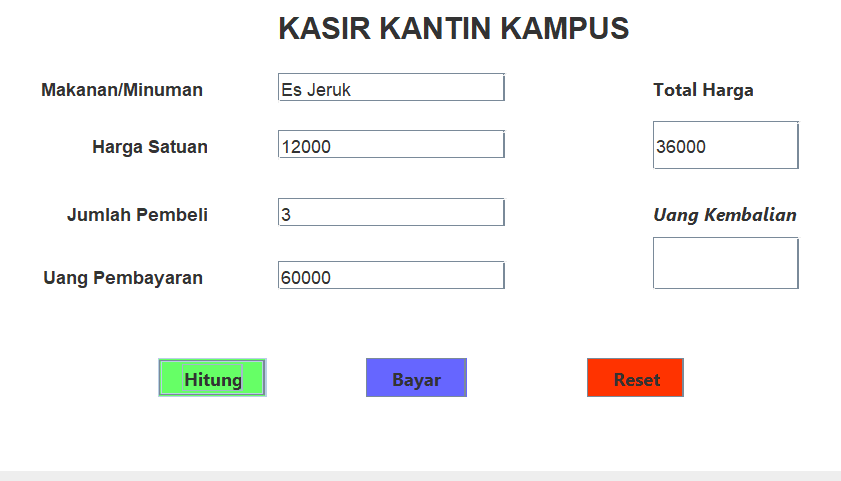

## Aplikasi Kasir Kantin Kampus

**Nama:** [Sindy Aulia]  
**NIM:** [C2483207018]  
**Kelas:** [PTI5]
**Mata Kuliah:** [Pemprograman Visual]

### Deskripsi
Aplikasi Kasir Kantin Kampus dibuat menggunakan Java Swing pada Apache NetBeans. Aplikasi ini digunakan untuk menghitung total belanja, menerima pembayaran, dan menghitung uang kembalian.

### Fitur
- Input nama barang
- Input harga barang
- Input jumlah barang
- Menghitung total harga
- Menghitung uang kembalian
- Validasi pembayaran
- Tombol Reset
### Komponen Java Swing
JFrame,JLabel,JTextField,JButton,JOptionPane,ActionListener.

### Cara Menjalankan Aplikasi Di NetBeans
-Buka aplikasi Apache NetBeans.
-Pilih menu File → Open Project.
-Pilih folder proyek KasirKantinKampus.
-Tunggu sampai proyek selesai dimuat.
-Buka Source Packages → kasirkantin → FromKasir.java.
-Klik kanan file FromKasir.java, lalu pilih Run File, atau klik tombol Run  Project.
-Tunggu sampai jendela aplikasi Kasir Kantin Kampus muncul.
-Masukkan nama barang, harga, jumlah, dan uang pembayaran.
-Klik tombol Hitung untuk menghitung total harga.
-Klik tombol Bayar untuk memproses pembayaran dan melihat uang kembalian.
-Klik tombol Reset untuk mengosongkan seluruh kolom.
### Hasil Pengujian
Pengujian 1 – Berhasil
- Nasi Goreng: Rp15.000 × 2
- Total: Rp30.000
- Pembayaran: Rp50.000
- Kembalian: Rp20.000
Pengujian 2 – 
- Es Jeruk: Rp12.000 × 3
- Total: Rp36.000
- Pembayaran: Rp60.000

### Screenshot Aplikasi

**1. Tampilan Aplikasi**

**2. Hasil Transaksi Berhasil**

**3. Pembayaran Kurang**

